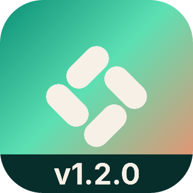
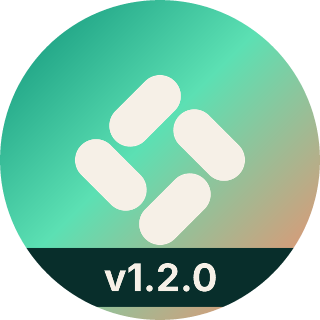
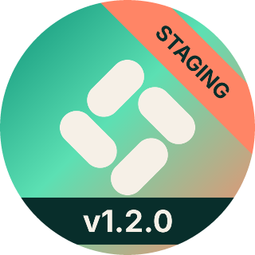

# expo-icon-overlays

<a href="https://useffect.sh/seal/tsyirvo/expo-icon-overlays"></a>

Add text banners and ribbons to Expo app icons during prebuild.
Use overlays to distinguish development, staging and production builds.
The plugin changes generated native icons, not your source images.

<table>
  <tr>
    <th></th>
    <th>Version banner</th>
    <th>Staging ribbon</th>
    <th>Banner and ribbon</th>
  </tr>
  <tr>
    <th>iOS</th>
    <td></td>
    <td></td>
    <td></td>
  </tr>
  <tr>
    <th>Android</th>
    <td></td>
    <td></td>
    <td></td>
  </tr>
</table>

This is a community package, not an official Expo package.

## Requirements

- Expo SDK 56, 57 or 58
- Node 22.13+, 24.3+ or 26+

## Install and configure

```sh
bun add expo-icon-overlays
```

Add the plugin to your existing `app.config.ts`:

```ts
import type { IconOverlayOptions } from "expo-icon-overlays";

const options = {
  overlays: [{ type: "banner", text: "DEV", background: "#D97706" }],
} satisfies IconOverlayOptions;

export default {
  expo: {
    name: "Example",
    slug: "example",
    plugins: [["expo-icon-overlays", options]],
  },
};
```

For production, set `enabled: false` or use `overlays: []`.
See the configuration guide for environment-based options and version text.

Run `bun expo prebuild`. Then create a new native build with your project's normal build command.
Repeat both steps after changing text, changing options or disabling overlays.
Do not use `prebuild --clean` unless you intend to regenerate the native projects.

## Options

| Field                   | Default                                        | Values                                                             |
| ----------------------- | ---------------------------------------------- | ------------------------------------------------------------------ |
| `enabled`               | `true`                                         | Boolean. `false` skips native changes.                             |
| `overlays`              | Required                                       | Array of overlays. An empty array changes no files.                |
| `overlays[].type`       | Required                                       | `banner` or `ribbon`.                                              |
| `overlays[].text`       | Required                                       | Supported Latin text. Use `{version}` for the app version.         |
| `overlays[].position`   | Banner: `bottom`. Ribbon: `top-right`.         | Banner: `top`, `bottom`. Ribbon: `top-left`, `top-right`.          |
| `overlays[].background` | `#111111`                                      | `#RGB` or `#RRGGBB`.                                               |
| `overlays[].color`      | Black or white, whichever has higher contrast. | `#RGB` or `#RRGGBB`. Tinted and monochrome icons use fixed colors. |

Overlays draw in array order. Each position must be unique.
A top banner cannot share an array with a ribbon.
Text shrinks to fit without truncation. Text that cannot fit causes a prebuild error.
Keep text to about 7 capital letters. See [text length](https://github.com/tsyirvo/expo-icon-overlays/blob/main/docs/guides/configuration.md#text-length) for the limits.
Invalid options cause errors, even when overlays are disabled.

## Scope and limits

- Icon changes require prebuild and a new native build. OTA updates cannot change icons.
- iOS PNG support includes single/light, dark and tinted icons.
- iOS Icon Composer (`.icon`) folders get overlay layers. Building them requires Xcode 26 or later.
  The overlay layers use one of the four groups Xcode allows.
- Android PNG support includes legacy, round, adaptive foreground and monochrome icons.
- Source icons, Android backgrounds and the web favicon stay unchanged.
- Disabling overlays leaves two unused layer files in the copied `.icon` folder until `prebuild --clean`.
- Installed variants need distinct application identifiers. The plugin does not set those identifiers.

## Documentation

- [Configuration](https://github.com/tsyirvo/expo-icon-overlays/blob/main/docs/guides/configuration.md): environments, version text and validation rules.
- [Build caching](https://github.com/tsyirvo/expo-icon-overlays/blob/main/docs/guides/build-caching.md): native fingerprints and cached builds.
- [Development](https://github.com/tsyirvo/expo-icon-overlays/blob/main/docs/guides/development.md): setup, checks and SDK test policy.
- [Rendering](https://github.com/tsyirvo/expo-icon-overlays/blob/main/docs/guides/rendering.md): previews, image references and font generation.

### Release setup

Maintainers: follow the [release procedure](https://github.com/tsyirvo/expo-icon-overlays/blob/main/docs/releasing.md).

## License

Package code: MIT.

The bundled [Inter](https://rsms.me/inter/) subset is by Rasmus Andersson and contributors.
See [assets/Inter-LICENSE.txt](assets/Inter-LICENSE.txt) for the SIL Open Font License 1.1.
The rasterizer dependency, `@resvg/resvg-wasm`, supplies its WASM asset under its own MIT license.
